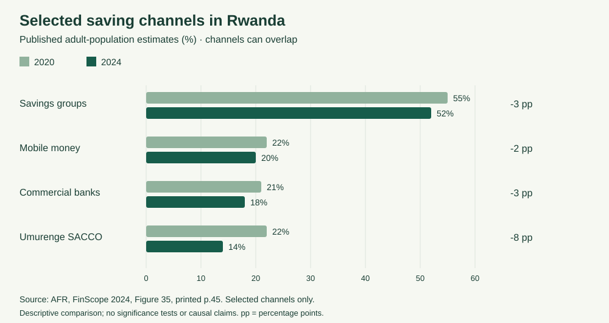

# Reproducible published-data analysis

## Question

How does reported savings-group participation compare with selected other saving channels, and how did the published percentages change between 2020 and 2024?

## Source and provenance

Access to Finance Rwanda, *FinScope 2024 report*, June 2024. [NISR catalogue](https://www.microdata.statistics.gov.rw/index.php/catalog/120), study RWA-NISR-FINSCOPE-2024-v01. [Report](https://statistics.gov.rw/sites/default/files/documents/2024-09/Rwanda-Finscope-2024-Report_compressed.pdf#page=45), Figure 35, printed page 45 (PDF page 45). Accessed 28 October 2026. Four channel pairs were manually transcribed and visually checked against the chart. The input is a small derived table, not respondent microdata. The original report remains available through the source link; it is not redistributed here.

Selection: groups, mobile money, commercial banks and Umurenge SACCO. These represent the group-management context and familiar payment/savings channels; they are not an exhaustive list. The report's savings-groups category also includes cooperatives and VSLA, not exclusively ibimina.

## Run

Requires Python 3. No packages, network connection, secrets or application server are needed once this repository is downloaded.

```sh
python analysis/analyze.py
```

Run from the repository root, or invoke the script by its full path. Input: [CSV](inputs/saving-channels.csv). Outputs: [CSV](results/comparison.csv), [JSON](results/comparison.json), [chart](results/saving-channels.svg). The JSON includes an input checksum. Re-running with unchanged input produces identical output bytes. Input validation checks distinct channels and percentage ranges; it cannot automatically establish that transcription is correct.



## Interpretation

Savings groups have the highest 2024 estimate among the selected channels. Their change is -3 percentage points, versus -2 for mobile money, -3 for commercial banks and -8 for Umurenge SACCO. This supports examining an established group-saving activity rather than assuming everyone needs their first financial service. It does not establish demand for this particular app.

The product implication is a hypothesis: retain group-controlled contributions, loans and treasurer confirmation while testing whether digital records help members. External payment recording does not imply integration with a bank, SACCO or mobile-money provider.

## Limits

- Population: survey adults aged 16 and older, not app users. These are rounded published estimates, not new weighted estimates calculated here.
- Percentages describe use within each year; the same people may use several channels. Do not add channel percentages or interpret differences as movement by individuals.
- A percentage-point change is subtraction, not a relative percentage change or a count change.
- No respondent data, sample-design computation, confidence intervals, significance tests or panel tracking are used. Small differences are descriptive only.
- No demographic findings, adoption forecast, explanation of changes, app impact or poverty reduction is estimated.
- The app's fictional transactions are separate from these official estimates. No survey records are linked to member accounts.
- This is a limited aggregate analysis, not a substitute for a fuller survey analysis or user research.
